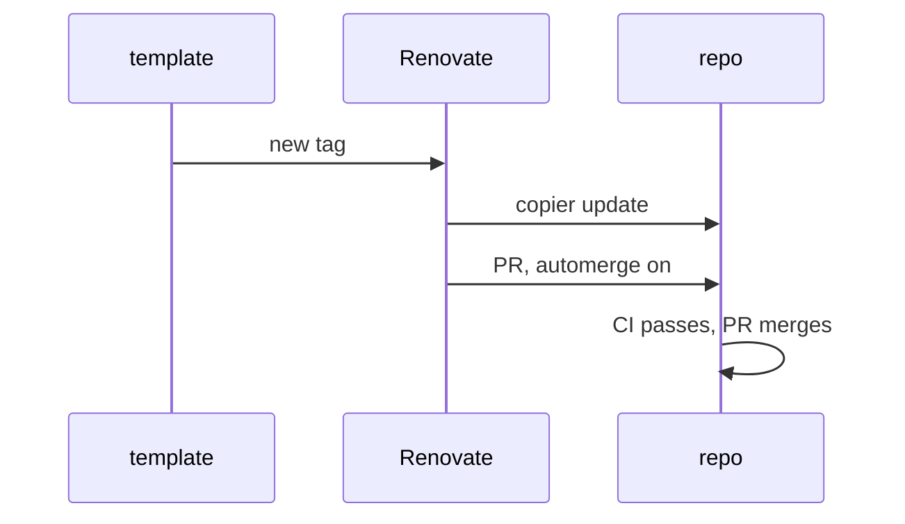

# High-Level Design: copier-python

This is the Python baseline template of [agentic_development](https://github.com/jmbowman/agentic_development) (`../agentic_development` locally). That repo's HLD defines the system, its glossary, the file-ownership model and the tenets, which all apply here.

## Problem

Every Python repo developed with this system needs the same strict tooling: ruff, ty, prek hooks, mise tasks, CI and Renovate. Today some have none, and keeping hand-copied config consistent fails as soon as the baseline changes. The baseline has to be applied to a repo once and then kept current automatically, and each repo's own adjustments have to survive every update.

## Approach

A copier template, released by git tag, that a repo applies with `copier copy` and that Renovate's copier manager keeps current with `copier update`.

- **Applies to new and existing repos.** The template adds tooling files. It never creates or rewrites package source, tests or `pyproject.toml` project metadata.
- **Template-owned base, repo-owned top.** Where a tool supports inheritance, the template owns the base config and the repo owns a thin top file that extends it. Named exceptions live in repo-owned files or as inline suppressions in code.
- **Per-repo knobs are copier questions,** kept to the few that tools can't discover themselves. Answers are stored in `.copier-answers.python.yml`. Changing an answer is a re-render, not a hand edit. A new question added in a template release takes its default during Renovate's update, so every new question needs a safe default.
- **Shared pieces are referenced, not copied.** The repo-owned CI stub calls the shared check workflow in agentic_development without passing inputs (the workflow reads the template-maintained tool pins and tasks), and the repo-owned `.github/renovate.json` extends that repo's preset, each pinned to a tag.
- **The LID coherence gate is always on.** `lidc check` runs in commit-time hooks and in CI, as it does across the system.
- **Onboarding an existing repo.** The repo's existing violations are fixed, or recorded as named exceptions, before or as part of the first `copier copy`, so the first CI run passes. The LLD defines how the exceptions are generated.

## Target Users

- **Python repos, new or existing,** from small stdlib CLIs upward, whose developers want the system's strict baseline.
- **Agents working in those repos.** They rely on the checks being present and strict, and they record any exception as a named exception rather than weakening the base.

## Goals

- `copier copy` plus a push gives a repo green CI on its first run, given code that passes the strict baseline or has its exceptions recorded.
- `copier update` to a new release completes without conflicts when the repo has edited only repo-owned files.
- `mise run check` runs every check locally. Commit-time hooks run the fast subset.
- ty runs at one pinned version with every rule at error level. ruff runs from `select = ["ALL"]` minus a commented list of exclusions.
- Every named exception in a consumer repo can be found with one documented search.

## Non-Goals

- **Package scaffolding:** no `src/` layout, CLI skeleton, docs site, release or publishing workflow.
- **Other languages and documentation tooling.** Those are separate template layers, each with its own answers file.
- **The instruction file (`AGENTS.md` / `CLAUDE.md`).** LID's `/update-lid` owns it, and a template-owned copy would conflict with every LID upgrade. The template doesn't render it at all. *Alternatives:* render a thin starting file once as repo-owned; or, later, provide template-owned fragments that `AGENTS.md` includes.
- **Tool choices per repo.** A repo can't swap ruff or ty for another tool through this template.

## Tenets

The system tenets apply. One more, local to templates:

1. **Clean updates over a rich first render.** Prefer the file shape that keeps later updates conflict-free, even when it makes the first render less convenient.

## System Design

Files rendered into a consumer repo, by owner. Template-owned files live in `.config/copier-python/`, linked from wherever a tool requires them. The [baseline files](intent/baseline-files/baseline-files-design.md) LLD holds the full table and the onboarding procedure.

| File | Owner | Purpose |
|---|---|---|
| `.copier-answers.python.yml` | copier | Answers and the template version, at the root where Renovate runs copier |
| `.config/copier-python/ruff.toml` | template | The strict baseline: `select = ["ALL"]` minus formatter conflicts, plus test relaxations |
| `.config/copier-python/ty.toml` | template | Every rule at error level, found through `TY_CONFIG_FILE`. Exceptions are inline `ty: ignore[rule]` comments in code |
| `.config/copier-python/uv.toml` | template | A 3-day `exclude-newer` delay for lock-file updates, linked from a root `uv.toml` |
| `.config/copier-python/mise.toml` | template | Pinned uv, ruff, ty, prek and `lidc`, plus the check tasks, linked from `.config/mise/conf.d/` |
| `.config/copier-python/prek.toml` | template | Commit-time hooks, each running a mise task |
| `.ruff.toml` | repo | Extends the base. Per-file named exceptions live here |
| `.config/mise/config.toml` | repo | Repo-specific tools and the `check-extra` and `hooks-extra` overrides |
| `.github/workflows/ci.yml` | repo | A short stub that calls the shared check workflow at a tag (rendered for the `github` forge) |
| `.github/workflows/lock-refresh.yml` | repo | A short stub that calls the shared lock-refresh workflow at a tag, so template updates arrive with a refreshed `mise.lock` (rendered for the `github` forge when the repo gives its lock-refresh App's client ID) |
| `.github/renovate.json` | repo | Extends the shared preset at a tag (rendered for the `github` forge) |
| `docs/arrows/index.yaml` | repo | The minimal file `lidc` requires |

1. Renovate sees a new copier-python tag through its git-tags datasource.
2. It runs `copier update --vcs-ref <tag>` without `--trust`. Template-owned files are re-rendered, the repo's edits to them are replayed, and repo-owned files are left alone.
3. It pushes an update branch and opens a PR with automerge enabled.
4. CI runs on the push, and GitHub merges the PR once the required check passes.

**Testing the template.** The template's tests render it with copier's Python API into temporary repos. Each test checks one ownership rule:
- a fresh copy passes `mise run check` on a small sample package;
- an update from one tagged version to the next keeps edits to repo-owned files and applies new template-owned content without conflicts;
- a template-owned file edited by hand produces the expected merge, not silent loss.

## Key Design Decisions

- **Built here, borrowing from published templates.** The surveyed Python copier templates (copier-astral, copier-uv, substrate, ss-python and others) all copy their CI workflows instead of referencing them. The two read in source leave ty unpinned or non-strict and need `--trust` for Jinja extensions. Borrowed: copier-uv's strict ruff base with a curated ignore list, and copier-astral's pytest rendering tests, extended with update tests, which neither has.
- **ruff `extend` for the base; inline suppressions for ty.** ruff's `extend` takes only a local path, so the base is copied into the repo and the thin top file inherits from it. ty has no `extends` mechanism, and per-path `[[overrides]]` would mean editing the template-owned file, so per-line suppressions carry ty's exceptions. *Alternative:* render ty overrides from a copier answer. That would put exceptions in the answers file, far from the code they excuse.
- **One template for now, not layered.** Base concerns (hooks, mise, Renovate stubs) stay in this template until a second language or documentation layer needs them. Then a `copier-base` layer is split out, and consumers move to two answers files.
- **The template repo doesn't consume itself yet.** Its own tooling is configured by hand at first. Applying the template to its own repo, as GitLab's infra template does, waits until the first release is stable.

**The tooling repos' own checks.** This repo isn't a template consumer yet. It has its own hand-written CI workflow, which runs `mise run check` from a root `mise.toml`, with the same strict profile and blocking `lidc` gate that consumers get. Its Renovate config extends agentic_development's shared preset. The shared check workflow isn't used here, because it requires `check` to come from `.config/mise/conf.d/`, which is reserved for template links and ignored by the preset. Its `.ruff.toml` excludes `template/` (whose `.ruff.toml` only works in consumers) and `tests/fixtures/`, and the `lint` task checks `template/.config/copier-python/exceptions.py` explicitly with `--config .ruff.toml`, which relies on ruff's `force-exclude` staying off. This changes once the template applies itself to its own repo.

## Success Metrics

- Renovate update PRs for this template merge automatically, without conflicts, in every consumer that has edited only repo-owned files.
- Each consumer's count of named exceptions goes down over time.
- The template's tests catch a broken render or a conflicting update before a tag is pushed.

## References

- System HLD: [agentic_development](https://github.com/jmbowman/agentic_development) `docs/high-level-design.md`.
- [copier configuration](https://copier.readthedocs.io/en/stable/configuring/); [ruff `extend`](https://docs.astral.sh/ruff/settings/#extend); [ty configuration](https://docs.astral.sh/ty/reference/configuration/); [ty suppression comments](https://docs.astral.sh/ty/suppression/); [prek configuration](https://prek.j178.dev/configuration/).
- Prior art: [copier-uv](https://github.com/pawamoy/copier-uv) (ISC), [copier-astral](https://github.com/ritwiktiwari/copier-astral) (MIT).
