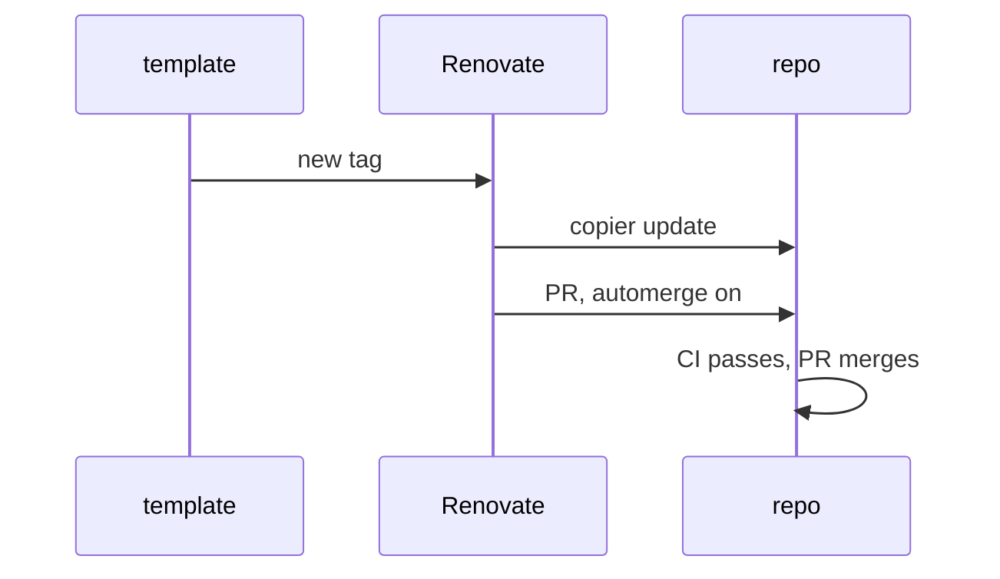

# High-Level Design: copier-python

This is the Python baseline template of [agentic_development](https://github.com/jmbowman/agentic_development) (`../agentic_development` locally). That repo's HLD defines the system, its glossary, the file-ownership model and the tenets, which all apply here.

## Problem

Every Python repo developed with this system needs the same strict tooling: ruff, ty, prek hooks, mise tasks, CI and Renovate. Today some have none, and keeping hand-copied config consistent fails as soon as the baseline changes. The baseline has to be applied to a repo once and then kept current automatically, and each repo's own adjustments have to survive every update.

## Approach

A copier template, released by git tag, that a repo applies with `copier copy` and that Renovate's copier manager keeps current with `copier update`.

- **Applies to new and existing repos.** The template adds tooling files. It never creates or rewrites package source, tests or `pyproject.toml` project metadata.
- **Template-owned base, repo-owned top.** Where a tool supports inheritance, the template owns the base config and the repo owns a thin top file that extends it. Named exceptions live in repo-owned files or as inline suppressions in code.
- **Per-repo knobs are copier questions,** kept to the few that tools can't discover themselves. Answers are stored in `.copier-answers.python.yml`. Changing an answer is a re-render, not a hand edit. A new question added in a template release takes its default during Renovate's update, so every new question needs a safe default.
- **Shared pieces are referenced, not copied.** The repo-owned CI stub calls the shared check workflow in agentic_development without passing inputs (the workflow reads the template-maintained tool pins and tasks), and the repo-owned `.github/renovate.json` extends that repo's preset, each pinned to a tag.
- **Skills are pinned by the template and installed from its lock file.** The template pins agentic_development's skills package in an APM manifest in `.config/copier-python/`, and renders the manifest and its lock file into each consumer. The package's own manifest brings LID's `linked-intent-dev` plugin with it, so the lock file holds both. The consumer's setup task, a session hook for cloud sessions, and its checks install exactly what the lock file records into `.config/copier-python/.claude/skills/`, which is gitignored. Links from the locations agents read skills lead there. A consumer gets skill updates as template updates, and can still manage its own skills beside the template's.
- **The LID coherence gate is always on.** `lidc check` runs in commit-time hooks and in CI, as it does across the system.
- **Onboarding an existing repo.** The repo's existing violations are fixed, or recorded as named exceptions, before or as part of the first `copier copy`, so the first CI run passes. The LLD defines how the exceptions are generated.

## Target Users

- **Python repos, new or existing,** from small stdlib CLIs upward, whose developers want the system's strict baseline.
- **Agents working in those repos.** They rely on the checks being present and strict, and they record any exception as a named exception rather than weakening the base.

## Goals

- `copier copy` plus a push gives a repo green CI on its first run, given code that passes the strict baseline or has its exceptions recorded.
- `copier update` to a new release completes without conflicts when the repo has edited only repo-owned files.
- `mise run check` runs every check locally. Commit-time hooks run the fast subset.
- ty runs at one pinned version with every rule at error level. ruff runs from `select = ["ALL"]` minus a commented list of exclusions.
- Every named exception in a consumer repo can be found with one documented search.

## Non-Goals

- **Package scaffolding:** no `src/` layout, CLI skeleton, docs site, release or publishing workflow.
- **Other languages and documentation tooling.** Those are separate template layers, each with its own answers file.
- **The instruction file (`AGENTS.md` / `CLAUDE.md`).** LID's `/update-lid` owns it, and a template-owned copy would conflict with every LID upgrade. The template doesn't render it at all. *Alternatives:* render a thin starting file once as repo-owned; or, later, provide template-owned fragments that `AGENTS.md` includes.
- **Tool choices per repo.** A repo can't swap ruff or ty for another tool through this template.

## Tenets

The system tenets apply. One more, local to templates:

1. **Clean updates over a rich first render.** Prefer the file shape that keeps later updates conflict-free, even when it makes the first render less convenient.

## System Design

Files rendered into a consumer repo, by owner. Template-owned files live in `.config/copier-python/`, linked from wherever a tool requires them. The [baseline files](intent/baseline-files/baseline-files-design.md) LLD holds the full table and the onboarding procedure.

| File | Owner | Purpose |
|---|---|---|
| `.copier-answers.python.yml` | copier | Answers and the template version, at the root where Renovate runs copier |
| `.config/copier-python/ruff.toml` | template | The strict baseline: `select = ["ALL"]` minus formatter conflicts, plus test relaxations |
| `.config/copier-python/ty.toml` | template | Every rule at error level, found through `TY_CONFIG_FILE`. Exceptions are inline `ty: ignore[rule]` comments in code |
| `.config/copier-python/uv.toml` | template | A 3-day `exclude-newer` delay for lock-file updates, linked from a root `uv.toml` |
| `.config/copier-python/mise.toml` | template | Pinned uv, ruff, ty, prek, `lidc` and `apm`, plus the check tasks, linked from `.config/mise/conf.d/` |
| `.config/copier-python/prek.toml` | template | Commit-time hooks, each running a mise task |
| `.config/copier-python/apm.yml`, `apm.lock.yaml` | template | The pin of agentic_development's skills package, and the lock file recording it and the LID plugin it brings, with each package's commit and each installed file's hash |
| `.config/copier-python/.gitignore` | template | Ignores the installed skills and APM's download cache |
| `.config/copier-python/session-start.sh` | template | The SessionStart hook: in a cloud session, installs mise, the pinned tools and the skills |
| `.claude/skills/<name>`, `.agents/skills/<name>` | template | A link to each of the template's skills in `.config/copier-python/.claude/skills/`, for Claude Code and for agents that read the cross-tool location |
| `.claude/settings.json` | repo | Registers the session hook. Repo-owned, because repos keep their own permissions and hooks there |
| `.ruff.toml` | repo | Extends the base. Per-file named exceptions live here |
| `.config/mise/config.toml` | repo | Repo-specific tools and the `check-extra` and `hooks-extra` overrides |
| `.github/workflows/ci.yml` | repo | A short stub that calls the shared check workflow at a tag (rendered for the `github` forge) |
| `.github/workflows/lock-refresh.yml` | repo | A short stub that calls the shared lock-refresh workflow at a tag, so template updates arrive with a refreshed `mise.lock` (rendered for the `github` forge when the repo gives its lock-refresh App's client ID) |
| `.github/renovate.json` | repo | Extends the shared preset at a tag (rendered for the `github` forge) |
| `docs/arrows/index.yaml` | repo | The minimal file `lidc` requires |

1. Renovate sees a new copier-python tag through its git-tags datasource.
2. It runs `copier update --vcs-ref <tag>` without `--trust`. Template-owned files are re-rendered, the repo's edits to them are replayed, and repo-owned files are left alone.
3. It pushes an update branch and opens a PR with automerge enabled.
4. CI runs on the push, and GitHub merges the PR once the required check passes.

Skill updates take one more step, in this repo: Renovate's apm manager bumps the skills package's pin in the template's APM manifest and commits the refreshed lock file, and its weekly lock-file maintenance refreshes the lock file too. The next template tag carries them to consumers through the flow above, and each consumer's next install picks them up. A package release that adds or removes a skill, LID's included, also needs its links added or removed by hand, and this repo's tests fail the PR until they match. A LID bump arrives inside a skills package release, reaches consumers the same way, and their LID version gate holds the update PR until someone runs `/update-lid` on its branch.

**Testing the template.** The template's tests render it with copier's Python API into temporary repos. Each test checks one ownership rule:
- a fresh copy passes `mise run check` on a small sample package;
- an update from one tagged version to the next keeps edits to repo-owned files and applies new template-owned content without conflicts;
- a template-owned file edited by hand produces the expected merge, not silent loss.

## Key Design Decisions

- **Built here, borrowing from published templates.** The surveyed Python copier templates (copier-astral, copier-uv, substrate, ss-python and others) all copy their CI workflows instead of referencing them. The two read in source leave ty unpinned or non-strict and need `--trust` for Jinja extensions. Borrowed: copier-uv's strict ruff base with a curated ignore list, and copier-astral's pytest rendering tests, extended with update tests, which neither has.
- **ruff `extend` for the base; inline suppressions for ty.** ruff's `extend` takes only a local path, so the base is copied into the repo and the thin top file inherits from it. ty has no `extends` mechanism, and per-path `[[overrides]]` would mean editing the template-owned file, so per-line suppressions carry ty's exceptions. *Alternative:* render ty overrides from a copier answer. That would put exceptions in the answers file, far from the code they excuse.
- **Skills installed from the template's lock file.** The template's `.config/copier-python/apm.yml` pins agentic_development's skills package, with `targets: [claude]`. The package's own manifest pins LID's `linked-intent-dev` plugin, and APM installs a package's dependencies with it, so LID comes with the package at the version agentic_development uses itself. In this repo, Renovate's apm manager bumps the pin and refreshes the lock file. In consumers, `apm install --frozen` in that directory deploys the skills to `.config/copier-python/.claude/skills/`, where the directory itself says they come from the template. It runs wherever something reads them: locally in the `setup` task, in cloud sessions through the session hook, and in CI through an install task that the checks reading skills depend on, so the stubs and the shared check workflow stay unchanged. The lock file pins each package's commit and each installed file's hash, so every install is reproducible, and a frozen install fetches by git alone. The cost is that a session or CI run without network access to GitHub has no packaged skills, and a fresh clone's skill links point nowhere until the first install. In every repo, `.claude/skills/` and `.agents/skills/` are real directories with one entry per skill: a link, or the installed files of a skill the repo deploys with its own `apm.yml`. The template contributes a link in each to each of its skills, and a skill developed in the repo lives in its own `skills/<name>/`, linked from both. *Alternatives:*
  - the installed skill files committed in each consumer (no install step, but a copy of another repo's files in every consumer and in every update diff, as committing `node_modules` would be);
  - each consumer pins the packages in its own `apm.yml` (a second update channel per repo, and `apm install` under Renovate in every consumer);
  - the template pinning LID itself, with agentic_development moving its own LID pin to `devDependencies`, which APM doesn't install for a package's users (the template could choose its LID version, and the shared preset's hold on LID bumps would cover its PRs; but it's a second pin to keep in step, and the system would run two LID versions whenever they diverged);
  - a plugin marketplace in the repo's Claude Code settings (cloud sessions don't install those plugins);
  - the template's skills as real files in `.claude/skills/` (no links to keep in step with the packages, but nothing marks those skills as the template's, and they read differently from a repo's own linked skills);
  - `.agents/skills` as one link to `.claude/skills` (no second set of links, but a repo can't then keep a skill for other agents only, and the directory isn't its own).
- **A LID version gate in every consumer's check.** Moving a repo to a new LID version needs a `/update-lid` walk of its design docs, which an automerged update can't do. A LID bump reaches a consumer inside a template update, which the copier manager automerges, and reaches this repo inside a skills package bump, which the shared preset's hold on LID bumps doesn't cover, so the consumer's `check` fails while the `- Version:` in its instruction file's `## LID` block differs from the LID version its installed lock file pins. A person runs `/update-lid` on the update's branch and pushes the walk, and the PR then merges. The template doesn't render the instruction file: the gate reads whichever of `AGENTS.md` and `CLAUDE.md` the repo has. *Alternatives:* each consumer pins LID in its own `apm.yml`, so the shared preset's hold on LID bumps covers it (a second update channel, for one package); holding template updates that change the LID pin (Renovate sees only the template's version, so detecting the change needs a check like this one anyway).
- **A template-owned session hook with a repo-owned registration** ([cloud sessions](intent/cloud-sessions/cloud-sessions-design.md)). Cloud sessions start from the clone with no mise, so a SessionStart hook installs mise, the pinned tools and the skills there, and does nothing in local sessions. The script is template-owned, so fixes reach every consumer. `.claude/settings.json`, which registers it, is repo-owned: repos keep their own permissions and hooks in that file, Claude Code has no way to include a second settings file, and a template-owned copy would conflict on every update. A change to the registration itself therefore reaches existing consumers only by hand. The hook pins its own mise version, which Renovate keeps equal to the mise version of this repo's own CI, so a consumer's cloud sessions run the mise current at its template release, while its CI runs the one in the check workflow it pins. *Alternatives:* a template-owned `settings.json` (conflicts with every repo's own settings); reading the mise version from the consumer's pinned check workflow at each session start (a network fetch and YAML parsing in the hook, and it assumes the repo-owned CI stub keeps the template's shape); taking the version from the check workflow at `agentic_development_ref` (two independent Renovate bumps that must land together); the cloud environment's own setup script (cached, but outside the repo, so neither versioned nor updated).
- **One template for now, not layered.** Base concerns (hooks, mise, Renovate stubs) stay in this template until a second language or documentation layer needs them. Then a `copier-base` layer is split out, and consumers move to two answers files. The skills pin, the session hook and the LID version gate are language-neutral, so they move to that layer too.
- **The template repo doesn't consume itself yet.** Its own tooling is configured by hand at first. Applying the template to its own repo, as GitLab's infra template does, waits until the first release is stable.

**The tooling repos' own checks.** This repo isn't a template consumer yet. It has its own hand-written CI workflow, which runs `mise run check` from a root `mise.toml`, with the same strict profile and blocking `lidc` gate that consumers get. Its Renovate config extends agentic_development's shared preset. The shared check workflow isn't used here, because it requires `check` to come from `.config/mise/conf.d/`, which is reserved for template links and ignored by the preset. Its `.ruff.toml` excludes `template/` (whose `.ruff.toml` only works in consumers) and `tests/fixtures/`, and the `lint` task checks the template's Python scripts (`exceptions.py` and `lid_version.py` in `template/.config/copier-python/`) explicitly with `--config .ruff.toml`, which relies on ruff's `force-exclude` staying off. It pins `apm`, and a root `apm.yml` pins LID's `linked-intent-dev` plugin for this repo's own sessions, installed from its lock file by `setup` and gitignored, with the same LID version gate consumers get. It has no session hook of its own: it sees few cloud sessions, and the template's hook serves consumers. Its ty config excludes `template/.config/copier-python/.claude`, where an `apm install` in the template (Renovate's, or a developer's) puts the template's skills: their scripts are checked in their own packages' repos and may import packages this repo doesn't install. This changes once the template applies itself to its own repo.

## Success Metrics

- Renovate update PRs for this template merge automatically, without conflicts, in every consumer that has edited only repo-owned files.
- Each consumer's count of named exceptions goes down over time.
- The template's tests catch a broken render or a conflicting update before a tag is pushed.

## References

- System HLD: [agentic_development](https://github.com/jmbowman/agentic_development) `docs/high-level-design.md`.
- [copier configuration](https://copier.readthedocs.io/en/stable/configuring/); [ruff `extend`](https://docs.astral.sh/ruff/settings/#extend); [ty configuration](https://docs.astral.sh/ty/reference/configuration/); [ty suppression comments](https://docs.astral.sh/ty/suppression/); [prek configuration](https://prek.j178.dev/configuration/).
- Prior art: [copier-uv](https://github.com/pawamoy/copier-uv) (ISC), [copier-astral](https://github.com/ritwiktiwari/copier-astral) (MIT).
